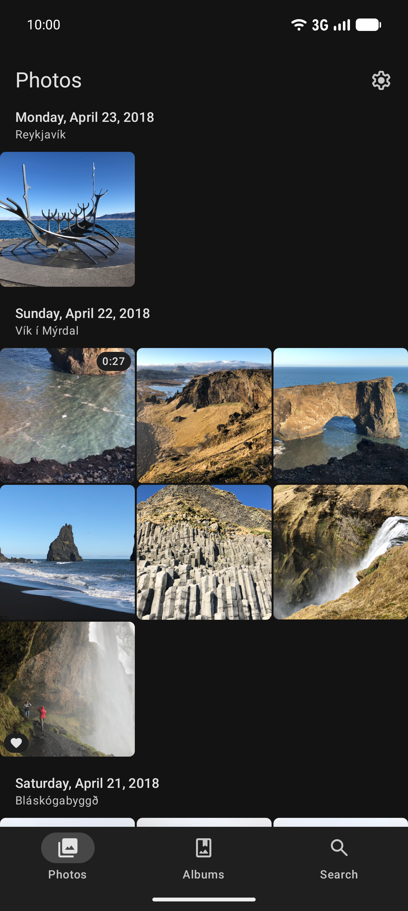
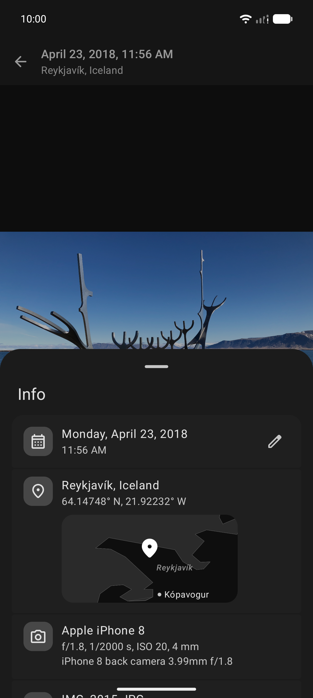
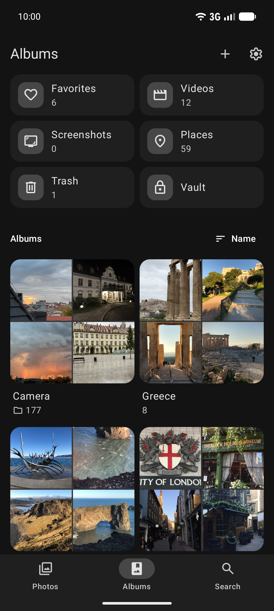
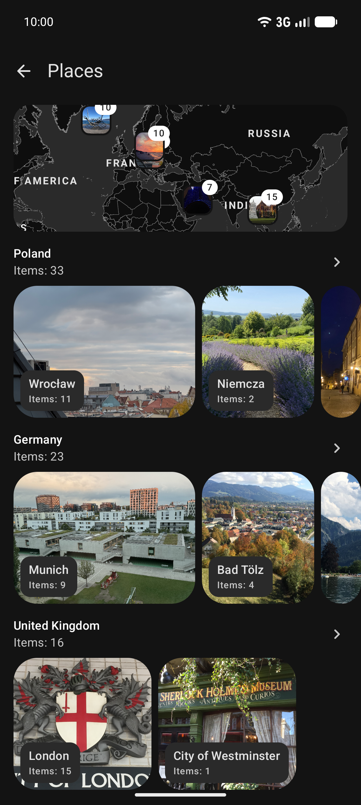
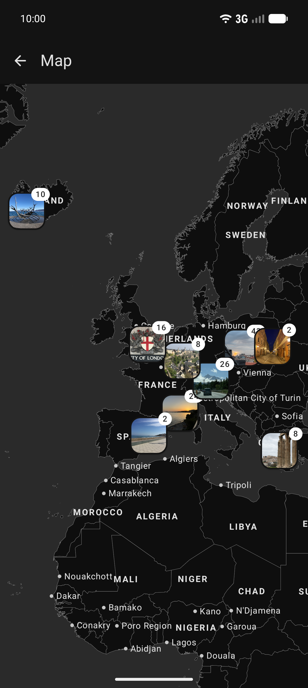
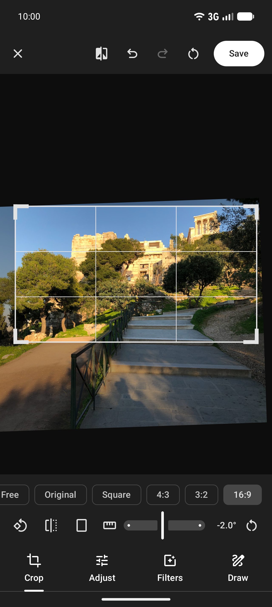

#  Gallery

A private gallery for Android: photos and videos by day, HDR, albums, places and an encrypted vault, with no Internet access.

**Current version**: v0.1.1

Source code and releases: [git.hnet.sh/hkr/gallery](https://git.hnet.sh/hkr/gallery)

Bug reports and feature requests: [github.com/legal-hkr/gallery](https://github.com/legal-hkr/gallery/issues)

## Overview

Gallery shows the photos and videos on your phone and is designed to be the only gallery you need. It has no Internet permission: places, the map and search use data built into the app, and nothing about you leaves the phone. Ultra HDR photos and HDR videos are shown in HDR, shared files have their location removed unless you choose otherwise, and an encrypted vault keeps private photos and videos on the phone.

## Screenshots

     

## Features

### Photos and videos

- **Timeline**: Photos and videos by day, in each photo’s own time zone, with the town it was taken in; pinch to change the number of columns, from two up to a whole month at a glance
- **HDR**: Ultra HDR photos and HDR videos (HDR10, HLG, Dolby Vision) shown in HDR, with an SDR toggle
- **Formats**: JPEG, HEIC, AVIF, PNG, WebP, RAW (DNG), motion photos, GIFs and animated WebP
- **Viewer**: Zoom to the photo’s full resolution; videos with frame-by-frame stepping, playback speeds and sound only when you want it
- **Info**: The date and time (editable), the place with a small map, the camera, lens and exposure

### Albums

- **Your albums**: Add an item to as many albums as you like; pinned albums first, sorted as you choose
- **Folders as sources**: Each folder can be shown in Photos, only as an album, or hidden; the app never moves your files between folders
- **Collections**: Favorites, Videos, Screenshots and Trash

### Places and search

- **Places**: Your photos by country and town, and a world map with clusters, from [Wikidata](https://www.wikidata.org) and [Natural Earth](https://www.naturalearthdata.com) data built into the app – nothing is downloaded
- **Search**: By date, place, album, type and file name, in English and Polish, with suggestions as you type

### Sharing and privacy

- **Without location**: Shared files have their location removed by default, with a switch right in the share sheet
- **Vault**: Encrypted on the phone and unlocked with your fingerprint or screen lock; move items in and out, or import from and export to any storage

### And also

- **Editor**: Crop with aspect ratios, rotate, mirror and straighten; adjust exposure, contrast, highlights, shadows, saturation, warmth and sharpness, or start from one of six filters; draw and write on photos; trim videos frame-accurately. Edits are saved as a copy or over the original, keeping Ultra HDR, HDR video and metadata
- **Slideshow**: Crossfade or Ken Burns, with videos played for up to 15 s
- **Other apps**: Opens photos and videos from other apps, and lets other apps pick photos and videos from Gallery
- **Backup and restore** of settings and albums to a file you choose
- **Language**: English or Polish, independent of the system language

## Requirements

- Android 14 (API level 34) or higher

## Building

```bash
git clone https://git.hnet.sh/hkr/gallery.git
cd gallery
./gradlew assembleDebug
```

Set the Android SDK path in `local.properties` (`sdk.dir=…`) first. Unit tests run with `./gradlew test`.

The place data (`app/src/main/assets/places.bin.gz`) is kept in the repository, so a build needs no network; `tools/places/build.py` makes it again from its sources (see the script for how).

## Contributing

Development happens on [git.hnet.sh](https://git.hnet.sh/hkr/gallery). The [GitHub repository](https://github.com/legal-hkr/gallery) is a read-only mirror, updated on every push, and the place to report problems:

- **Issues**: Open them on [GitHub](https://github.com/legal-hkr/gallery/issues), with the app version and your Android version
- **Pull requests**: Welcome on GitHub as well, but they can’t be merged there – accepted changes are applied on git.hnet.sh and reach the mirror from there, so the pull request itself ends up closed rather than merged

## Tech stack

- **Language**: Kotlin
- **Min SDK**: Android 14 (API 34), **target SDK**: API 37
- **UI**: Jetpack Compose with Material 3 Expressive
- **Places**: Built-in data and its own lookup of the nearest town, region and country, all on the device

## License

[GPL-3.0](https://www.gnu.org/licenses/gpl-3.0.en.html)

## Acknowledgments

- Names, positions and populations of towns and villages come from [Wikidata](https://www.wikidata.org), available under [CC0 1.0](https://creativecommons.org/publicdomain/zero/1.0/)
- Borders and names of countries and regions come from [Natural Earth](https://www.naturalearthdata.com), in the public domain
- [Claude](https://claude.ai) by Anthropic – AI assistant that provided valuable support during the development process, helping with code implementation, architecture decisions, and documentation