#  Gallery

Private gallery for photos and videos on Android.

**Status**: in development, nothing released yet.

Source code: [git.hnet.sh/hkr/gallery](https://git.hnet.sh/hkr/gallery)

Bug reports and feature requests: [github.com/legal-hkr/gallery](https://github.com/legal-hkr/gallery/issues)

## Requirements

- Android 14 (API level 34) or higher

## Building

```bash
git clone https://git.hnet.sh/hkr/gallery.git
cd gallery
./gradlew assembleDebug
```

Set the Android SDK path in `local.properties` (`sdk.dir=…`) first. Unit tests run with `./gradlew test`.

The place data (`app/src/main/assets/places.bin.gz`) is kept in the repository, so a build needs no network; `tools/places/build.py` makes it again from its sources (see the script for how).

## Contributing

Development happens on [git.hnet.sh](https://git.hnet.sh/hkr/gallery). The [GitHub repository](https://github.com/legal-hkr/gallery) is a read-only mirror, updated on every push, and the place to report problems:

- **Issues**: Open them on [GitHub](https://github.com/legal-hkr/gallery/issues), with the app version and your Android version
- **Pull requests**: Welcome on GitHub as well, but they can’t be merged there – accepted changes are applied on git.hnet.sh and reach the mirror from there, so the pull request itself ends up closed rather than merged

## Tech stack

- **Language**: Kotlin
- **Min SDK**: Android 14 (API 34), **target SDK**: API 37
- **UI**: Jetpack Compose with Material 3 Expressive
- **Places**: Built-in data and its own lookup of the nearest town, region and country, all on the device

## License

[GPL-3.0](https://www.gnu.org/licenses/gpl-3.0.en.html)

## Acknowledgments

- Names, positions and populations of towns and villages come from [Wikidata](https://www.wikidata.org), available under [CC0 1.0](https://creativecommons.org/publicdomain/zero/1.0/)
- Borders and names of countries and regions come from [Natural Earth](https://www.naturalearthdata.com), in the public domain
- [Claude](https://claude.ai) by Anthropic – AI assistant that provided valuable support during the development process, helping with code implementation, architecture decisions, and documentation
